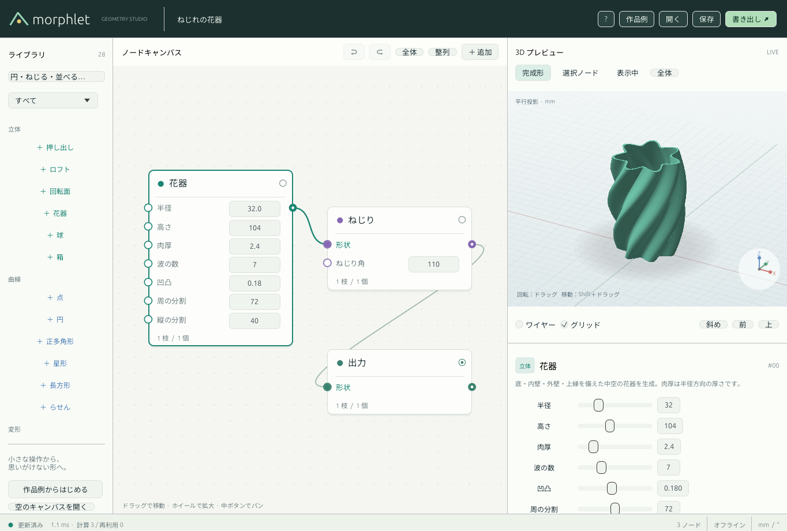

# Morphlet（仮称）0.1

**ノードをつないで、形を作る。** 日本語を中心にした、独立したデスクトップ用ノードモデラです。Rhinoのインストールやログインは不要で、モデリング・保存・書き出しをオフラインで行えます。



## まず使ってみる

1. **Windows用ZIPをすべて展開**し、展開先の **`Morphlet.exe`** を起動します。配布版を使うだけならRustのインストールは不要です。
2. 最初に開く **「ねじれの花器」** で、中央の **花器** ノードをクリックします。
3. 右下の設定で **高さ・半径・凹凸** を変更します。**ねじり** ノードを選び、ねじり角を変えると形が変わります。
4. **保存**から名前とフォルダーを選び、編集できる **`.morph`** ファイルを残します。
5. **書き出し ↗** で **STL** または **OBJ** を選びます。STLをスライサーで開くときは単位を **mm** にしてください。

3D画面は左ドラッグで回転、ホイールで拡大・縮小できます。形やノードが見切れたら **全体** または `F`、操作を戻すには `Ctrl+Z`。左の検索欄では「箱」「ねじり」「花器」や `box`・`twist`・`vase` を探せます。

詳しい作り方と操作は **[はじめての使い方](docs/USER_GUIDE_JA.md)** にまとめています。

**Windows実機での操作確認はまだ行っていません。** この版の確認環境と結果は [検証記録](docs/VERIFICATION.md) を参照してください。

## この版でできること

| 分野 | 内容 |
|---|---|
| ノード編集 | 28種類のノード、日本語・英語検索、追加、配線、自動接続、複製、複数選択、整列 |
| 形状生成 | 箱・球・花器、円・星形・らせん、押し出し、ロフト、回転面 |
| 形状の調整 | 移動、回転、拡大縮小、ねじり、波形変形、直線配列・円形配列 |
| データ | 数値、演算、数列、データツリー、フラット化、枝分け |
| 3D表示 | 完成形・選択ノード・表示中の結果、回転・平行移動・ズーム、グリッド・ワイヤー表示 |
| 保存 | `.morph`形式、Undo/Redo、復旧用の自動保存、アプリ内のファイル選択 |
| 書き出し | 三角形メッシュのバイナリSTL・OBJ。境界辺や面方向などの検査 |
| 編集可能な作品例 | 花器、球のリング、星のトーテム、らせん、波打つブロック、数列からのロフトの6種類 |

数値を変えたときは、影響を受けるノードを再計算します。幾何計算は画面操作とは別の処理で実行し、古い計算結果が最新の設定を上書きしないようにしています。

## 形状と互換性の範囲

この版の形状は **点・折れ線・三角形メッシュ** です。円やロフトも分割した形状として扱います。

**NURBS・B-rep、STEP、Rhinoの3DM、GrasshopperのGH/GHX、GHAプラグイン、ブーリアン演算、AIによるノード生成は未実装**です。「メッシュをまとめる」は複数のメッシュをまとめる処理で、交差部分を取り除く和演算ではありません。

3Dプレビューは面を奥から手前へ並べる方式なので、複雑な交差部分では表示順が正確でない場合があります。書き出し前の検査も自己交差・最小肉厚・造形成功の完全な判定ではありません。詳細は [保存・出力の仕様](docs/IO_NOTES.md) を参照してください。

MorphletはGrasshopperのようなノードによる形状制作を参考にした独立実装です。Rhino/Grasshopperの本体を切り出したものや、既存定義をそのまま動かす互換版ではありません。

## 配布版の中身

| ファイル・フォルダー | 役割 |
|---|---|
| `Morphlet.exe` | Windows用の実行ファイル |
| `examples/` | 6つの`.morph`作品。メッシュの作品にはSTLも付属 |
| `docs/` | 操作、設計、検証、ライセンスの説明 |
| `licenses/` | 依存ライブラリ等のライセンス文面 |
| `src/`・`tests/`・`Cargo.toml`・`Cargo.lock` | Rustソースコードとテスト。ビルド・変更したい人向け |

作品を編集したら、配布サンプルと別の名前で保存すると元の作品例を残せます。

## 開発者向け：ソースからビルドする

### 前提

- **Rust 1.100.0を推奨**します。この版で検証したツールチェーンです。
- `Cargo.toml`の`rust-version = "1.88"`はパッケージが宣言する最低バージョンです。現在の`Cargo.lock`に固定された依存関係全体がRust 1.88でビルドできることは確認していません。
- WindowsでMSVC版Rustを使う場合は、**Visual StudioのC++ Build Tools**と対応するWindows SDKが必要です。[Rust公式のWindows向け説明](https://rust-lang.github.io/rustup/installation/windows.html)
- 初回の依存取得にはネット接続が必要な場合があります。ビルド後のアプリの基本機能はオフラインで利用できます。

Windows用ZIPには実行ファイルと完全なソースを同梱しています。展開したフォルダーの`Cargo.toml`と同じ場所がソースのルートです。

### Windows / PowerShell

ソースのルートで実行します。

```powershell
.\scripts\build-windows.ps1
```

このスクリプトはテストを実行してからリリース版をビルドし、各コマンドが失敗した場合は停止します。ツールチェーンの自動インストールや、PowerShellの実行ポリシー変更は行いません。

スクリプトを実行できない環境では、同じフォルダーで以下を直接実行してください。テストが成功してからビルドへ進みます。

```powershell
cargo test --all-targets --locked
cargo build --release --locked --bin Morphlet
```

Cargoの標準設定での生成先は`target\release\Morphlet.exe`です。`--locked`により同梱の`Cargo.lock`を維持します。[Cargoのビルド設定](https://doc.rust-lang.org/cargo/commands/cargo-build.html)

### ソースの構成

| 場所 | 内容 |
|---|---|
| `src/model.rs`・`src/engine.rs` | 型付きグラフ、接続検証、評価、形状生成 |
| `src/app.rs`・`src/canvas.rs`・`src/viewport.rs` | デスクトップ画面、ノード編集、3Dプレビュー |
| `src/persistence.rs`・`src/file_picker.rs` | 保存・出力・履歴・ファイル選択 |
| `src/templates.rs` | サンプルグラフの生成 |
| `tests/` | 保存・出力などの統合テスト。各モジュールにも単体テストあり |
| `assets/` | 日本語フォントなどのアプリ資産 |
| `scripts/` | ビルド補助 |

構造と次の拡張順序は [実装構成](docs/ARCHITECTURE.md)、実行した検証と残る確認事項は [検証記録](docs/VERIFICATION.md) を参照してください。

## ドキュメントとライセンス

- [はじめての使い方](docs/USER_GUIDE_JA.md)
- [実装構成と今後の拡張](docs/ARCHITECTURE.md)
- [検証記録](docs/VERIFICATION.md)
- [保存・出力の仕様](docs/IO_NOTES.md)
- [第三者ライセンス・出典](docs/THIRD_PARTY_NOTICES.md)

本アプリのソースはMITまたはApache-2.0の選択式ライセンスです。フォントや依存ライブラリにはそれぞれのライセンスが適用されます。同梱のライセンス文面と第三者ライセンス一覧を確認してください。
