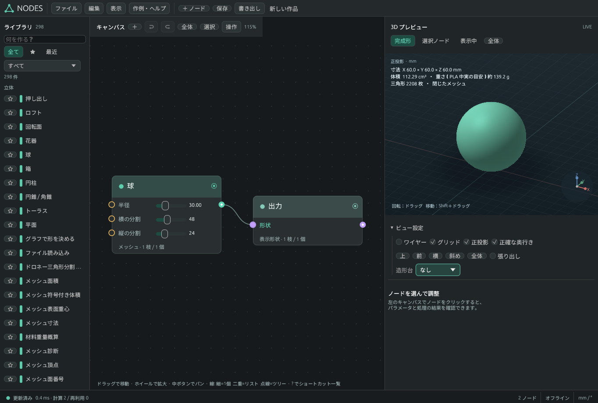

# NODES

**ノードをつないで、形を作る。** 日本語を中心にした、独立型デスクトップのパラメトリックCADです。Rhino・Grasshopperのインストールやログインは不要で、基本のモデリング、保存、書き出しはオフラインで利用できます。

現在のΩ開発は [feat/nodes-omega-geometry](https://github.com/07egta/NODES/tree/feat/nodes-omega-geometry) と [Draft PR #16](https://github.com/07egta/NODES/pull/16) で進めています。以前の統合成果・関連PRの履歴も保全しています。**開発版であり、Grasshopperの完全互換版ではありません。** 最新の実行結果、既知の制限、再開手順は [TEST_RESULTS.md](TEST_RESULTS.md) と [開発チェックポイント](docs/development/STATUS.md) を参照してください。

[使い方](docs/USER_GUIDE_JA.md) · [ノード対応表](NODE_COVERAGE.md) · [設計](docs/ARCHITECTURE.md) · [実装言語方針](docs/LANGUAGE_POLICY.md) · [ロードマップ](ROADMAP.md) · [CI](https://github.com/07egta/NODES/actions)

## 実装言語

**本体はRust。必要な補助部分にだけ、少量の他言語を使います。** GUI・ノード評価・Data Tree・幾何処理・保存・CLIはRustで開発し、既存のeframe/eguiによるネイティブUIを継続します。

開発用のPython/PowerShellと、ユーザーが使う制限付きRhaiスクリプト機能は維持します。通常のアプリ利用にPython、Node.js、.NETのインストールは要求しません。適用範囲と例外の扱いは [実装言語方針](docs/LANGUAGE_POLICY.md)、開発エージェント向けの引き継ぎは [AGENTS.md](AGENTS.md) に記録しています。

## 入手する

- **検証済み開発版:** 数値・幾何・書き出し・直接数値入力のソース `25f981b794e3e0f037cd664915ce144347b49f40` の [Windows ZIP](https://github.com/07egta/NODES/actions/runs/45916077764/artifacts/15163120765) / [Linux ZIP](https://github.com/07egta/NODES/actions/runs/45916077764/artifacts/15162711183) を取得できます。CI成果物は安定リリースではありません。最新Windowsの実画面操作と実機造形は未検証です。
- **旧公開版:** [NODES 0.1.0 Windows ZIP](https://github.com/07egta/NODES/releases/download/v0.1.0/NODES-0.1.0-Windows-x64.zip)。この旧版には現在の開発ブランチで追加した機能は含まれません。
- **ソースから:** 下記のビルド手順を使います。実行ファイル名は互換性のため `NODES.exe` を維持しています。

[Check 45916077764](https://github.com/07egta/NODES/actions/runs/45916077764) はLinux **523 passed**、Windows **521 passed**、各0 failed / 3 ignoredで成功しました。両OSのGUI/CLI release buildと、Linuxのfmt/check/strict Clippy・Python17件・独立数値oracle・依存監査も成功しています。件数差はUnix限定FIFO回帰2件です。`25f981b` の実GUIでは直接数値入力・保存・分割STL出力・light/darkの案内表示を確認しました。後続preview-cache修正の結果と混同せず、ソース別のCI・配布物を [検証記録](docs/development/OMEGA_CI_RESULTS.json) に記録します。

WindowsでランタイムDLLが見つからない場合は、[Microsoft公式の実行時ランタイム導入手順](docs/WINDOWS_RUNTIME.md)を参照してください。配布exeを使うためにRustやC++ Build Toolsを導入する必要はありません。

## 最初のモデルを編集する

1. ZIPを展開し、`NODES.exe` を起動します。
2. 「ねじれの花器」の花器ノードを選び、高さ・半径・凹凸を変更します。ねじりノードでねじり角を調整できます。
3. 左の検索で「円」「点を並べたい」「ねじり」や `circle`、`array`、`twist` を探し、必要なノードを追加します。
4. 保存操作から編集可能な `.morph` グラフを残します。配布サンプルとは別名で保存すると元の作例を維持できます。
5. メッシュをSTLで書き出し、外部スライサーで寸法・向き・造形条件を確認します。

3D画面はドラッグで回転、ホイールでズームします。全体表示は `F`、操作を戻すには `Ctrl+Z`、やり直すには `Ctrl+Y`。ノードごとの表示切り替え、値・データツリーの確認、エラー表示、辞典も利用できます。詳細は [日本語操作ガイド](docs/USER_GUIDE_JA.md) を参照してください。



上の画像はc44a897aのLinuxバイナリを実行して撮影しました。新規Sphereの半径25、直接入力30で寸法60 × 60 × 60 mm、30.123456のフォーカス離脱後の保持、半径500、Undo、保存・終了・再起動・再編集・STL出力を確認しています。表示だけで25を25.1へ変えてしまう不具合を修正し、実画面と4件のheadless egui回帰で再検証しました。以前のInspectorフォーカス・行間修正の実画面も [保存](docs/development/screenshots/linux-after-inspector-layout.png) しています。最新Windowsの画面操作と広いDPIの検証は残っています。[数値入力の実操作記録](docs/development/NUMERIC_INPUT_VALIDATION.json) / [検証結果](TEST_RESULTS.md)

> **曲線・メッシュ修復・曲げなどの追加分（18種類、作品例11・12）の確認状況：** コンパイルもテスト実行もしていません。CIが最初の確認になります。対応表は [Grasshopperとの対応](docs/GH_COVERAGE.md) を、使い方は [使い方](docs/USER_GUIDE_JA.md) の「曲線・メッシュ・形の追加分」を参照してください。

> **リスト・式・印刷向けノード（20種類）の確認状況：** 作品例09・10、関連テストを含め、コンパイルもテスト実行もしていません。CIが最初の確認になります。対応表は [Grasshopperとの対応](docs/GH_COVERAGE.md) を参照してください。

## 現在の実装範囲

選択欄に **298種類**、定義から作るClusterを含めて **299種類の登録**があります。登録数は完全実装数・Grasshopper互換性の検証数ではありません。機能ごとの範囲は [ノード対応表](NODE_COVERAGE.md) に記載しています。

| 分野 | 実装した機能 | 主な制限 |
|---|---|---|
| グラフ評価 | 型付き入力、循環検出、決定的な順序、増分再計算、キャッシュ、キャンセル、古い結果の破棄、ノード別時間 | 単一出力モデル。計算ワーカーは1本。同じ階層のノードは並列評価（thread::scope） |
| Data Tree | Path・枝、Flatten/Graft/Simplify、リスト演算、Path Mapper制限構文、Shortest/Longest/Cross | native Null、一般の混合アクセス、GH全件の期待値比較が未完了 |
| 数学・ベクトル | 四則、三角/指数/対数、統計、集合、補間、行列、点と座標変換 | Boolean・Vector・Domainは専用の値型へ移行予定 |
| 曲線 | 解析曲線、Bezier/B-spline/NURBS、評価、導関数、長さ、分割、変換 | 数学的な曲線と表示点列を分離。一般交差・オフセット・フィレットの対応は限定 |
| 曲面・ソリッド | NURBS・解析曲面、押し出し、ルールド面、回転面、Iso Curve、法線、曲率 | B-rep演算は箱などの限定ケース。一般のトリム・Boolean・Fillet・Shellは未完成 |
| Mesh / SubD | 構築、面積・体積、境界/非多様体診断、溶接、平滑化、細分化、限定修復 | 永続SubD/Crease、一般メッシュBoolean、完全な自己交差・肉厚判定は未完成 |
| 生成デザイン | グリッド、2D Voronoi/Delaunay/Convex Hull、配置、場、ノイズ、変形 | 3D Voronoi、一般Morph/Flow/最適化は未完成 |
| 編集・表示 | 日本語/英語検索、最近使ったノード、Undo/Redo、複数選択、整列、グループ、注釈、ツリー表示、ライト/ダーク | 大規模画面のフレーム時間、各DPI、Intel Arc、最新Windows GUIの計測は未実施 |
| ファイル | native JSON、STL/OBJ、試験的3MF、限定GHX解析/変換 | GH binary、STEP/IGES/3DM/glTFは未対応。未知nativeノードは読み込み拒否で元ファイルを保護 |
| 拡張・自動化 | 制限付きRhai、数式、Cluster、安全なJSONグラフAPI | 外部プラグインABI、GH Script互換、一般MCPサーバーは未完成 |

> **ノードの選び方（ノード棚・アイコン・★お気に入り・おすすめ次のノード・Space で検索）の確認状況：** コンパイルもテスト実行もしていません。CIが最初の確認になります。カテゴリ分け・候補の絞り込み・お気に入りの保存形式の単体テストを `src/node_shelf.rs` に、アイコン表の確認を `src/node_icons.rs` に書きましたが、実行はしていません。使い方は [使い方](docs/USER_GUIDE_JA.md) の「ノードの選び方」を参照してください。

> **画面と操作の改善（暗い画面・明るい画面の切り替え、カード上のスライダー、検索の並び替えと↑↓Enter、線を離して追加、`?`のショートカット一覧、`Home`、格子への吸着）の確認状況：** コンパイルもテスト実行もしていません。CIが最初の確認になります。検索の並び替えなどの処理は `src/ui_polish.rs` に単体テストを書きましたが、実行はしていません。使い方は [使い方](docs/USER_GUIDE_JA.md) の「画面と操作の改善」を参照してください。

精密なNURBSデータ、限定B-rep、近似メッシュは別の型として扱います。「メッシュをまとめる」はBoolean Unionではありません。STL出力とメッシュ診断は、実機での造形成功を保証するものではありません。G-codeの花瓶モードは実機未検証の補助機能です。

## 編集できる作例

`examples/` に **37種類のグラフ**があります。花器、ハニカム、Voronoi、ラティス、建築外装、らせん階段、曲線・曲面、NURBS、曲率比較などを含みます。各グラフのパラメータ変更、保存・再読み込み、再評価を確認する統合テストを追加しています。実際に成功したテストの範囲は [TEST_RESULTS.md](TEST_RESULTS.md) を参照してください。

数値を変えると影響先だけを再計算します。10,000ノードの検証では、中間ノードの編集で下流5,000ノードだけを再計算する契約を確認します。ヘッドレス計算の測定と、GUIの体感速度・メモリ使用量は別に評価しています。

## ソースからビルドする

- **Rust 1.100.0** をCIで使用します。`Cargo.toml` の宣言下限は1.88ですが、固定された依存関係全体の1.88でのビルドは未確認です。
- Windows MSVCではVisual Studio C++ Build ToolsとWindows SDKが必要です。[Rust公式の手順](https://rust-lang.github.io/rustup/installation/windows.html)
- Linuxのデスクトップ用開発パッケージは [CI workflow](.github/workflows/windows.yml) を参照してください。
- 初回の依存取得にはネット接続が必要な場合があります。実行時の基本機能にクラウドサービスは必要ありません。

```powershell
cargo fmt --all -- --check
cargo check --all-targets --locked
cargo clippy --all-targets --locked -- -D warnings
cargo test --all-targets --locked
cargo build --release --locked --bins
```

Windowsの生成先は `target\release\NODES.exe` です。`--locked` は同梱の `Cargo.lock` を維持します。ビルドを簡略化する [scripts/build-windows.ps1](scripts/build-windows.ps1) もあります。実行したコマンドと環境は [検証結果](TEST_RESULTS.md) に記録しています。

## オフラインCLI

独立したコンソール版 nodes-cli は、JSONの入出力で catalog・validate・evaluate・build・apply・export-stl を実行します。Windowsでは nodes-cli.exe をPowerShellから使えます。GUIとは別の実行ファイルなので標準出力を取得できます。

スクリプト・外部ファイル読み込み・プラグインを実行しない制限付きGraph APIを使用します。変更したグラフは評価に成功してから保存し、作品名や表示設定を保持します。STLは明示的なOutputだけを選択し、空・無効・非メッシュの出力を黙って省略しません。使い方とJSONの契約は [CLI.md](docs/CLI.md) を参照してください。

## ドキュメントとライセンス

- [開発を再開する](docs/development/STATUS.md)
- [実装構成](docs/ARCHITECTURE.md) / [ロードマップ](ROADMAP.md)
- [対応・検証の数え方](NODE_COVERAGE.md) / [公式資料の調査記録](docs/compatibility/REFERENCE_NOTES.md)
- [日本語操作ガイド](docs/USER_GUIDE_JA.md) / [保存・出力の仕様](docs/IO_NOTES.md)
- [依存関係の監査範囲と未確認事項](docs/DEPENDENCIES.md)
- [第三者ライセンス・出典](docs/THIRD_PARTY_NOTICES.md)

本アプリのソースはMITまたはApache-2.0の選択式ライセンスです。フォントと依存ライブラリにはそれぞれのライセンスが適用されます。新しい依存関係を追加する際は、ライセンスと再配布条件を確認してください。NODESは公開資料と数学を根拠にした独立実装であり、Rhino/Grasshopperの本体や非公開SDKを同梱しません。
