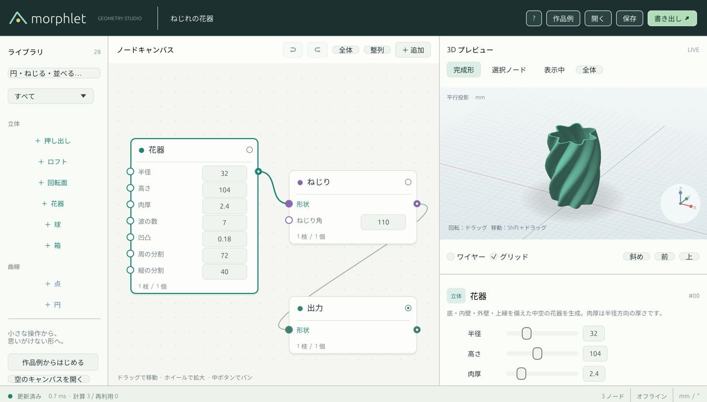

# NODES

**ノードをつないで、形を作る。** 日本語を中心にした、独立したデスクトップ用ノードモデラです。Rhinoのインストールやログインは不要で、モデリング・保存・書き出しをオフラインで行えます。

[Windows版をダウンロード（ZIP・10.5 MiB）](https://github.com/07egta/NODES/releases/download/v0.1.0/Morphlet-0.1.0-Windows-x64.zip) · [使い方](docs/USER_GUIDE_JA.md) · [開発に参加する](CONTRIBUTING.md)

最初の公開版は Morphlet 0.1.0 です。展開したフォルダーで `Morphlet.exe` を開いてください。



## まず使ってみる

1. **Windows用ZIPをすべて展開**し、展開先の **`Morphlet.exe`** を起動します。配布版を使うだけならRustのインストールは不要です。
2. 最初に開く **「ねじれの花器」** で、中央の **花器** ノードをクリックします。
3. 右下の設定で **高さ・半径・凹凸** を変更します。**ねじり** ノードを選び、ねじり角を変えると形が変わります。
4. **保存**から名前とフォルダーを選び、編集できる **`.morph`** ファイルを残します。
5. **書き出し ↗** で印刷用の **STL**（既定）・3MF（試験的）・OBJ を選びます。STL は mm で書き出し、検査と自動修復を行ってから、スライサーで開けます。手順は [使い方](docs/USER_GUIDE_JA.md#stlで書き出して印刷する) を参照してください。

3D画面は左ドラッグで回転、ホイールで拡大・縮小できます。形やノードが見切れたら **全体** または `F`、操作を戻すには `Ctrl+Z`。左の検索欄では「箱」「ねじり」「花器」や `box`・`twist`・`vase` を探せます。

詳しい作り方と操作は **[はじめての使い方](docs/USER_GUIDE_JA.md)** にまとめています。

Windowsで配布版を起動し、花器の3D表示と付属の6作品の読み込み・計算を確認しました。[検証記録](docs/VERIFICATION.md)

## この版でできること

| 分野 | 内容 |
|---|---|
| ノード編集 | 81種類のノード（28種類に14種類、リスト・式・ノイズ・印刷向けの20種類、ファイル読み込み1種類、曲線・メッシュ修復・曲げなどの18種類を追加）とスクリプトノード、日本語・英語検索、追加、配線、自動接続、複製、複数選択、整列 |
| ノードの選び方（未検証） | 上部の**ノード棚**（カテゴリタブ・アイコン・★お気に入り）、ノードを1つ選ぶと出る**おすすめ次のノード**、ドラッグ配置、`Space` で検索（ポインタの位置に追加） |
| ファイル読み込み（未検証） | **STL**（バイナリ・ASCII）と**OBJ**（頂点と面のみ）を読み込み、倍率・XY中心・床置きを指定。「ファイルを選ぶ」またはウィンドウへのドラッグで追加 |
| 形状生成 | 箱・球・花器・円柱・円錐/角錐・トーラス・平面、円・星形・らせん、押し出し、ロフト、回転面 |
| 形状の調整 | 移動、回転、拡大縮小、非一様スケール、ミラー、ねじり、波形変形、直線配列・円形配列 |
| データ | 数値、演算（足し算・引き算・掛け算・割り算・べき乗・絶対値・最小・最大・剰余）、三角関数、数列、範囲、データツリー、フラット化、枝分け |
| リスト・式・パターン（未検証） | リスト項目、リスト長、反転、並べ替え、間引きパターン、シフト、連結、部分リスト、範囲を調べる、再マップ、**式**（x・y・z・w の数式）、乱数、ランダムな点、ノイズ、距離、点の成分 |
| 3Dプリント向け（未検証） | **グラフで形を決める**（半径のリストから器）、**ノイズ変形**、**厚みをつける**（面を印刷できる壁に）、**張り出しチェック**（下向きの急な面の割合） |
| 自由に作る（未検証） | **スクリプトノード**（Rhai。数値・リスト・点・メッシュを返す）、**まとめノード**（複数ノードを1つの部品に。`.morph`に保存、`.morphpart`で書き出し・読み込み） |
| 迷わないために（未検証） | 線と札でデータの形（1個・リスト・ツリー）を表示、**値を見る**（枝・番号・値の表）、オフラインの**ノード辞典**（`F1`）、ノードの**無効化**（`Ctrl+E`）、**グループ**（`Ctrl+G`）と**メモ**、エラー理由をノード下とステータス行に表示 |
| 3D表示 | 完成形・選択ノード・表示中の結果、回転・平行移動・ズーム、グリッド・ワイヤー表示 |
| 3Dプリント向けの表示（未検証） | 造形台（Bambu A1・A1 mini・Adventurer 5M・カスタム）と、はみ出しの赤表示、寸法・体積・PLAの重さの目安・閉じたメッシュの確認、張り出し（45°など）のオレンジ表示、上・前・横・斜め・全体の視点、正投影/透視の切り替え、交差部分も正しく描く奥行き処理 |
| 保存 | `.morph`形式、Undo/Redo、復旧用の自動保存、アプリ内のファイル選択 |
| 書き出し | 三角形メッシュのバイナリSTL・OBJ。境界辺や面方向などの検査。その他の書き出しから **G-code（花瓶モード・未検証）** |
| 編集可能な作品例 | 花器、球のリング、星のトーテム、らせん、波打つブロック、数列からのロフト、サイン波の塔、べき乗の山脈、ノイズの花器（厚みつき）、引力点のパターン、パイプのらせんランプ、ジャイロイドの小物入れの12種類 |

> **自由に作る機能（スクリプトノード・まとめノード・`.morphpart`）の確認状況：** コンパイルもテスト実行もしていません。CIが最初の確認になります。追加した依存 `rhai` に合わせて `Cargo.lock` を手で書き足しました（`--locked` が通るかは未確認です。失敗したら `cargo update -p rhai` で更新してください）。実際の使い方は [使い方](docs/USER_GUIDE_JA.md)、制限と設計は [実装構成](docs/ARCHITECTURE.md) の第10章を参照してください。上の表の「配布版0.1.0」の確認記録には含まれません。

> **ファイル読み込み（STL・OBJ）の確認状況：** コンパイルもテスト実行もしていません。`tests/import_tests.rs` の小さな標本（立方体のバイナリ・ASCII STL、OBJ、壊れたファイル、NaN）を含め、CIが最初の確認になります。読み込み時の上限は 64 MiB・25万頂点・50万三角形です。使い方は [使い方](docs/USER_GUIDE_JA.md) の「ファイルを読み込む」を参照してください。
> **G-code（花瓶モード）の確認状況：** コンパイルもテスト実行もしていません。実機での印刷確認もしていません。STLが主な書き出しで、G-codeは補助機能です。詳しくは [保存・出力の仕様](docs/IO_NOTES.md) の第12章を参照してください。

> **曲線・メッシュ修復・曲げなどの追加分（18種類、作品例11・12）の確認状況：** コンパイルもテスト実行もしていません。CIが最初の確認になります。対応表は [Grasshopperとの対応](docs/GH_COVERAGE.md) を、使い方は [使い方](docs/USER_GUIDE_JA.md) の「曲線・メッシュ・形の追加分」を参照してください。

> **リスト・式・印刷向けノード（20種類）の確認状況：** 作品例09・10、関連テストを含め、コンパイルもテスト実行もしていません。CIが最初の確認になります。対応表は [Grasshopperとの対応](docs/GH_COVERAGE.md) を参照してください。

> **3Dプリント向けの表示（造形台・寸法・張り出し表示・奥行きバッファ）の確認状況：** コンパイルもテスト実行もしていません。CIが最初の確認になります。純粋関数（体積・重さ・寸法・はみ出し・張り出しの判定・奥行きバッファの描画）の単体テストを `src/print_info.rs`・`src/raster.rs` に追加しました。使い方は [使い方](docs/USER_GUIDE_JA.md) の「3Dプリント向けの表示」を参照してください。

> **この追加分の確認状況：** 追加した14種類のノード、作品例07・08、関連テストは、コンパイルもテスト実行もしていません。ビルドできる環境でのレビューが必要です。上記の「Windowsで…確認しました」は配布版0.1.0（28種類・6作品）についての記録です。

> **ノードの選び方（ノード棚・アイコン・★お気に入り・おすすめ次のノード・Space で検索）の確認状況：** コンパイルもテスト実行もしていません。CIが最初の確認になります。カテゴリ分け・候補の絞り込み・お気に入りの保存形式の単体テストを `src/node_shelf.rs` に、アイコン表の確認を `src/node_icons.rs` に書きましたが、実行はしていません。使い方は [使い方](docs/USER_GUIDE_JA.md) の「ノードの選び方」を参照してください。

> **画面と操作の改善（暗い画面・明るい画面の切り替え、カード上のスライダー、検索の並び替えと↑↓Enter、線を離して追加、`?`のショートカット一覧、`Home`、格子への吸着）の確認状況：** コンパイルもテスト実行もしていません。CIが最初の確認になります。検索の並び替えなどの処理は `src/ui_polish.rs` に単体テストを書きましたが、実行はしていません。使い方は [使い方](docs/USER_GUIDE_JA.md) の「画面と操作の改善」を参照してください。

> **迷わないための機能（データの形の表示・値を見る・ノード辞典・無効化・グループ/メモ）の確認状況：** コンパイルもテスト実行もしていません。CIが最初の確認になります。使い方は [使い方](docs/USER_GUIDE_JA.md) の「迷わないための機能」を参照してください。

数値を変えたときは、影響を受けるノードを再計算します。幾何計算は画面操作とは別の処理で実行し、古い計算結果が最新の設定を上書きしないようにしています。

## 形状と互換性の範囲

この版の形状は **点・折れ線・三角形メッシュ** です。円やロフトも分割した形状として扱います。

**NURBS・B-rep、STEP、Rhinoの3DM、GrasshopperのGH/GHX、GHAプラグイン、ブーリアン演算、AIによるノード生成は未実装**です。「メッシュをまとめる」は複数のメッシュをまとめる処理で、交差部分を取り除く和演算ではありません。

3Dプレビューの面は、既定でソフトウェアの奥行きバッファ（20万三角形まで）で描くため交差部分も前後が合います（未検証）。ワイヤー表示中や「正確な奥行き」をオフにしたときは従来の並べ方式で、交差部分の表示順が正確でない場合があります。書き出し前の検査も自己交差・最小肉厚・造形成功の完全な判定ではありません。詳細は [保存・出力の仕様](docs/IO_NOTES.md) を参照してください。

MorphletはGrasshopperのようなノードによる形状制作を参考にした独立実装です。Rhino/Grasshopperの本体を切り出したものや、既存定義をそのまま動かす互換版ではありません。

## 配布版の中身

| ファイル・フォルダー | 役割 |
|---|---|
| `Morphlet.exe` | Windows用の実行ファイル |
| `examples/` | `.morph`作品。配布版0.1.0は6つ。メッシュの作品にはSTLも付属（`07`〜`10`のSTLは未生成） |
| `docs/` | 操作、設計、検証、ライセンスの説明 |
| `licenses/` | 依存ライブラリ等のライセンス文面 |
| `src/`・`tests/`・`Cargo.toml`・`Cargo.lock` | Rustソースコードとテスト。ビルド・変更したい人向け |

作品を編集したら、配布サンプルと別の名前で保存すると元の作品例を残せます。

## 開発者向け：ソースからビルドする

### 前提

- **Rust 1.100.0を推奨**します。この版で検証したツールチェーンです。
- `Cargo.toml`の`rust-version = "1.88"`はパッケージが宣言する最低バージョンです。現在の`Cargo.lock`に固定された依存関係全体がRust 1.88でビルドできることは確認していません。
- WindowsでMSVC版Rustを使う場合は、**Visual StudioのC++ Build Tools**と対応するWindows SDKが必要です。[Rust公式のWindows向け説明](https://rust-lang.github.io/rustup/installation/windows.html)
- 初回の依存取得にはネット接続が必要な場合があります。ビルド後のアプリの基本機能はオフラインで利用できます。

Windows用ZIPには実行ファイルと完全なソースを同梱しています。展開したフォルダーの`Cargo.toml`と同じ場所がソースのルートです。

### Windows / PowerShell

ソースのルートで実行します。

```powershell
.\scripts\build-windows.ps1
```

このスクリプトはテストを実行してからリリース版をビルドし、各コマンドが失敗した場合は停止します。ツールチェーンの自動インストールや、PowerShellの実行ポリシー変更は行いません。

スクリプトを実行できない環境では、同じフォルダーで以下を直接実行してください。テストが成功してからビルドへ進みます。

```powershell
cargo test --all-targets --locked
cargo build --release --locked --bin Morphlet
```

Cargoの標準設定での生成先は`target\release\Morphlet.exe`です。`--locked`により同梱の`Cargo.lock`を維持します。[Cargoのビルド設定](https://doc.rust-lang.org/cargo/commands/cargo-build.html)

### ソースの構成

| 場所 | 内容 |
|---|---|
| `src/model.rs`・`src/engine.rs` | 型付きグラフ、接続検証、評価、形状生成 |
| `src/app.rs`・`src/canvas.rs`・`src/viewport.rs` | デスクトップ画面、ノード編集、3Dプレビュー |
| `src/persistence.rs`・`src/file_picker.rs` | 保存・出力・履歴・ファイル選択 |
| `src/gh_nodes.rs`・`src/expr.rs` | リスト・乱数・ノイズ・厚み・張り出しチェックのノード、式ノードの数式（長さと入れ子を制限） |
| `src/import.rs` | STL・OBJの読み込み（サイズ上限・頂点の溶接・有限な座標の検査）。ファイル読み込みノードの計算 |
| `src/script.rs`・`src/cluster.rs`・`src/script_ui.rs` | スクリプトの実行環境（制限つき）、まとめノードと`.morphpart`、その編集画面 |
| `src/templates.rs` | サンプルグラフの生成 |
| `src/annotations.rs`・`src/data_view.rs`・`src/help.rs` | グループ・メモ（保存と上限）、値を見る・データの形、ノード辞典 |
| `src/node_shelf.rs`・`src/node_icons.rs` | ノード棚（カテゴリタブ・★お気に入り・おすすめ次のノード・配置）と、ノードのアイコン表。分類・候補・保存形式は単体テスト付き |
| `src/ui_polish.rs`・`src/theme.rs` | 検索の並び替え・最近使ったノード・格子・画面の色の保存・ショートカット一覧（純粋な処理と単体テスト）、配色 |
| `tests/` | 保存・出力などの統合テスト。各モジュールにも単体テストあり |
| `assets/` | 日本語フォントなどのアプリ資産 |
| `scripts/` | ビルド補助 |

構造と次の拡張順序は [実装構成](docs/ARCHITECTURE.md)、実行した検証と残る確認事項は [検証記録](docs/VERIFICATION.md) を参照してください。

## ドキュメントとライセンス

- [はじめての使い方](docs/USER_GUIDE_JA.md)
- [実装構成と今後の拡張](docs/ARCHITECTURE.md)
- [検証記録](docs/VERIFICATION.md)
- [保存・出力の仕様](docs/IO_NOTES.md)
- [Grasshopperとの対応](docs/GH_COVERAGE.md)
- [第三者ライセンス・出典](docs/THIRD_PARTY_NOTICES.md)

本アプリのソースはMITまたはApache-2.0の選択式ライセンスです。フォントや依存ライブラリにはそれぞれのライセンスが適用されます。同梱のライセンス文面と第三者ライセンス一覧を確認してください。
